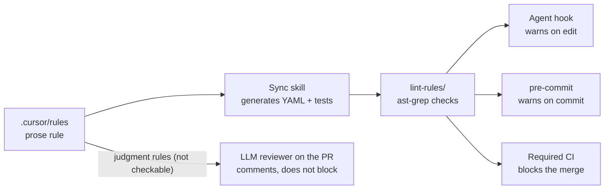

# Executable code rules: from .cursor/rules to automated checks

Nov 19, 2026 · Matias Gimenez

## The problem

The team's conventions are already written in `.cursor/rules`, next to the skills and commands. People know them, but nothing guarantees they are followed: when someone (or the agent) skips one, it is caught by hand in code review.

That has three costs:

- Reviews spent on conventions instead of design and logic.
- Micromanagement: flagging the same thing over and over to different people.
- Inconsistency: what gets flagged depends on who reviews and how much attention they have that day.

The goal is for every rule that can be verified to be verified automatically, and for failures to show up as early as possible: while the code is being written, at commit time, or, as a last resort, in the PR.

## The core idea

`.cursor/rules` remains the single source of truth, written in prose as it is today. Automated checks are the executable version of those same rules, not a second place to define them.

- People and the agent read `.cursor/rules` before writing code (prevention).
- Checks catch whatever still slips through (safety net).
- Each check points to the rule it comes from, and each rule lists the checks that enforce it.
- An agent translates new or changed rules into checks, so nobody writes them by hand.

## How it fits together



Checkable rules go through the skill and end up as YAML that runs in three places; only CI blocks. Judgment rules go straight to the LLM reviewer on the PR.

## Tools

The foundation is **ast-grep**: YAML rules over the AST (tree-sitter), one file per rule, with `scan` to run them, `test` to test them, optional autofix, an LSP for the editor, and an existing pre-commit hook. It is the format an agent writes most easily.

| Tool | What for | When to use it |
| --- | --- | --- |
| [ast-grep](https://ast-grep.github.io/reference/yaml.html) | Code patterns in YAML | By default, for most rules |
| Semgrep / Opengrep | YAML patterns with somewhat more semantic analysis | If ast-grep falls short for a rule |
| Fixit (Meta, on LibCST) | Rules written in Python, with autofix | Logic that does not fit a pattern, e.g. an `__init__` that only assigns `self.x = x` |
| import-linter | Contracts between modules | Architecture rules, e.g. `domain` does not import from `infra` |
| LLM reviewer on the PR | Comments on judgment rules | What no linter can verify |

**Why not Ruff:** Ruff does not support custom rules; plugins are reimplemented inside Ruff ([Ruff FAQ](https://docs.astral.sh/ruff/faq)). It is still used for the standard rules, but our own rules live elsewhere.

## Three kinds of rules

Not every rule in `.cursor/rules` can be verified the same way. Each falls into one of three groups:

| Kind | Examples | How it is checked | Blocks? |
| --- | --- | --- | --- |
| Code patterns | Pydantic instead of `@dataclass`; no `print`; no classes with verbose manual constructors | ast-grep (or Fixit when logic is needed) | Yes, deterministic failure |
| Architecture | `domain` does not import from `infra`; routers do not access the database directly | import-linter | Yes |
| Judgment | Descriptive names; a function does one thing | LLM reviewer on the PR that reads `.cursor/rules` | No, it comments |

The third group cannot be fully automated, but the LLM reviewer takes most of that load off human reviews.

## Repo layout and example

```
repo/
├── .cursor/rules/            # source of truth (prose)
│   └── python-models.mdc
├── lint-rules/
│   ├── sgconfig.yml          # ast-grep config
│   ├── rules/                # one YAML per check
│   │   └── prefer-pydantic-over-dataclass.yml
│   └── rule-tests/           # valid and invalid cases
│       └── prefer-pydantic-over-dataclass-test.yml
├── .pre-commit-config.yaml
└── .github/workflows/lint-rules.yml
```

`lint-rules/sgconfig.yml`:

```yaml
ruleDirs:
  - rules
testConfigs:
  - testDir: rule-tests
```

`lint-rules/rules/prefer-pydantic-over-dataclass.yml`:

```yaml
id: prefer-pydantic-over-dataclass
language: Python
severity: error
message: Use pydantic.BaseModel instead of @dataclass
note: |
  Project models use Pydantic for consistent validation
  and serialization.
metadata:
  source: .cursor/rules/python-models.mdc
rule:
  kind: decorator
  regex: dataclass
```

`lint-rules/rule-tests/prefer-pydantic-over-dataclass-test.yml`:

```yaml
id: prefer-pydantic-over-dataclass
valid:
  - |
    class User(BaseModel):
        name: str
invalid:
  - |
    @dataclass
    class User:
        name: str
  - |
    @dataclasses.dataclass(frozen=True)
    class User:
        name: str
```

Commands: `ast-grep test -c lint-rules/sgconfig.yml` verifies the rules, and `ast-grep scan -c lint-rules/sgconfig.yml` verifies the code. Before relying on it, check the exact syntax against the [ast-grep reference](https://ast-grep.github.io/reference/yaml.html).

## Traceability between rules and checks

The link goes both ways, so it is clear what is covered and a change to a rule surfaces the check that needs updating.

- **YAML → rule:** `metadata.source` points to the `.mdc` the check comes from (see the example above).
- **Rule → YAML:** at the end of each `.mdc`, a short section lists the check ids. A judgment-only rule is marked as such, so it does not count as missing.

```markdown
## Checks
- enforced-by: prefer-pydantic-over-dataclass
- enforced-by: no-manual-init-boilerplate
```

```markdown
## Checks
- enforcement: llm-review
```

**Coverage check (optional):** a short CI script that fails if an `.mdc` lists an id with no YAML, if a YAML points to an `.mdc` that does not exist, or if an `.mdc` has no Checks section. That way no new rule goes without a decision on how it is verified.

## Sync skill

A skill (for example `sync-rules`) the agent runs when a rule is added to or changed in `.cursor/rules`. Steps:

1. Read the new or changed `.mdc` files (or all of them, for a full sync).
2. Classify each rule: code pattern, architecture or judgment.
3. For each checkable rule with no YAML, write `rules/<id>.yml` with `message` (what to use instead), `note` (why) and `metadata.source`.
4. Write `rule-tests/<id>-test.yml` with at least one valid case and two invalid ones, and run `ast-grep test` until it passes.
5. Run `ast-grep scan` over the repo. If there are existing violations: fix them, or ship the rule as `warning` until the migration is done, so nobody is blocked all at once.
6. Add or update the `.mdc`'s Checks section.
7. Commit the rule, its tests and the `.mdc` together, in their own PR.

If a rule changed meaning, the skill updates or deletes the matching YAML instead of adding a new one.

## Where the checks run

The same command runs in three places. CI is what guarantees compliance; the other two warn earlier, which is more convenient.

| Where | What it adds | Can be skipped |
| --- | --- | --- |
| Agent hook (Cursor / Claude Code), after each edit | The agent sees the failure and fixes it on the spot | Yes, if the agent is not used |
| pre-commit | Stops the commit on the author's machine | Yes, with `--no-verify` |
| GitHub Actions, as a required check (branch protection) | Nothing that violates a rule reaches `main` | No |

`.pre-commit-config.yaml` (existing hook; pin the current version):

```yaml
- repo: https://github.com/boidolr/ast-grep-pre-commit
  rev: <version>
  hooks:
    - id: ast-grep
      args: ["--config", "lint-rules/sgconfig.yml"]
```

By default, only rules with `error` severity make the commit fail.

`.github/workflows/lint-rules.yml`:

```yaml
name: lint-rules
on: [pull_request]
jobs:
  ast-grep:
    runs-on: ubuntu-latest
    steps:
      - uses: actions/checkout@v4
      - run: pip install ast-grep-cli
      - run: ast-grep test -c lint-rules/sgconfig.yml
      - run: ast-grep scan -c lint-rules/sgconfig.yml
```

The LLM reviewer for judgment rules runs as a separate step on the same PR and only comments.

## Decisions made

- **No custom wrapper around ast-grep.** It already has what is needed; a wrapper adds maintenance, moves away from the official documentation (which the agent knows best), and tends to break editor integration.
- **A thin layer, yes:** a single command (`make lint-rules` or `just`) that uses the same invocation in the hook, pre-commit and CI, and groups import-linter or Fixit if they are added.
- **`.cursor/rules` is the source of truth.** YAML is derived from it; nobody defines rules directly in YAML without their `.mdc`.
- **CI is the check that counts.** The hook and pre-commit are there to warn earlier, not to guarantee.
- **New rules ship as `warning`** if the repo has existing violations, and move to `error` once the migration is done.

## Trial plan

A small, end-to-end trial in a single repo before scaling.

- [ ] Install ast-grep (`pip install ast-grep-cli`) and create `lint-rules/` with `sgconfig.yml`.
- [ ] Pick 2 or 3 easy-to-check rules from `.cursor/rules` (e.g. Pydantic instead of `@dataclass`).
- [ ] Write their YAML and tests by hand (or with the agent) and confirm `ast-grep test` passes.
- [ ] Run `ast-grep scan` over the repo and note how many violations and false positives there are.
- [ ] Add the pre-commit hook and confirm it stops a commit with a violation.
- [ ] Add the GitHub Actions workflow and make it a required check.
- [ ] Write the `sync-rules` skill and test it end to end with a new rule.
- [ ] Wire the agent hook so it runs the scan after each edit.
- [ ] Decide whether import-linter and the LLM reviewer are worth adding, based on which rules are still uncovered.

## Open questions

- Do the rules live in each repo, or in a shared central repo (consumed as a pre-commit repo or a submodule)?
- Who approves a new rule before it moves to `error`?
- Which LLM reviewer to use on the PR, and at what cost per PR?
- How are legitimate exceptions handled? ast-grep accepts an inline `# ast-grep-ignore: <id>`; we still need to decide whether exceptions require a justification.
- Does the skill run on demand, or does a CI check trigger it when `.cursor/rules` changes?
