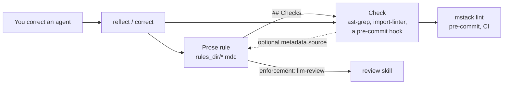
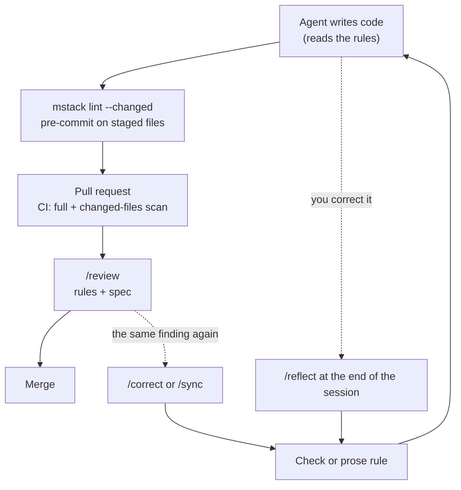

# How to use mstack

This is the end-to-end workflow: set up a machine once, adopt rules as checks in a repo, then turn recurring corrections into automated checks or guidance for review. The [README](../README.md) has the reference tables; [`src/mstack/README.md`](../src/mstack/README.md) documents every command and flag.

mstack works the same on Linux, macOS, Windows and WSL, with Claude Code, Cursor or both, so you can bring it to any machine you work on.

## The idea in one picture



- An `.mdc` file gives agents guidance for decisions that automated checks leave open.
- Each rule ends with a `## Checks` section that names how it is enforced: `enforced-by: <id>` (an ast-grep rule or an import-linter contract), `enforced-by-hook: <id>` (a pre-commit hook such as gitleaks), or `enforcement: llm-review` (a judgment call that only a reviewer can check).
- A check can stand on its own. If an ast-grep check declares `metadata.source`, `mstack coverage` verifies the prose file exists and lists the check.
- `mstack lint` runs everything: the checks' own tests, the scan, import-linter and the guards. The same command runs locally, in pre-commit and in CI.

## 1. Set up a machine (once per machine)

You need git, [`uv`](https://docs.astral.sh/uv/), and Claude Code or Cursor.

```bash
git clone https://github.com/justmatias/mstack
cd mstack
claude "set up mstack"          # Cursor, opencode: /setup-mstack; Codex: $setup-mstack
```

The setup skill (`.agents/skills/setup-mstack/`) runs from the checkout and is never installed. It:

1. installs the `mstack` CLI (`uv tool install --editable <checkout>`), which brings its own ast-grep and import-linter;
2. asks which tools you use, and runs `mstack platform` to find their folders (on WSL, Cursor reads the Windows profile);
3. compares every skill, rule, agent, MCP server, setting and global instruction with what you already have, and shows one plan;
4. asks only where your own setup differs, backs up anything it replaces to `<folder>/.mstack-backups/<timestamp>/`, and applies the plan;
5. runs `mstack doctor` until it reports no errors.

Rules reach Claude Code as `~/.claude/rules/<name>.md`, in the form `mstack render-rule` prints. Cursor keeps user rules in its settings, so for Cursor the skill prints them for you to paste.

**Verify any time:** `mstack doctor` checks the tools, the CLI, the checkout, every skill and rule, and whether an installed copy drifted from the checkout. `/repair` applies the fixes it prints.

## 2. Adopt rules as checks in a repo (once per repo)

1. **Scaffold the layout.** `mstack init --dry-run` shows the plan; add `--pre-commit`, `--ci github` and `--makefile` for the optional pieces. It writes `.mstack.toml`, an ast-grep `sgconfig.yml` with empty `rules/` and `rule-tests/`, and the rules folder (default `.cursor/rules/`). It never overwrites a file.
2. **Turn the existing rules into checks.** Run `/sync`. It reads the repo's rules (`.cursor/rules/`, `AGENTS.md`, `CLAUDE.md`, copilot instructions), splits them into atomic statements, and sorts each one into **pattern** (ast-grep), **architecture** (import-linter) or **judgment** (`llm-review`). For each checkable rule it writes the check, its tests and a synthetic copy of a real past mistake that the check must catch. Nothing is written before you approve the plan.
3. **Pick the severity.** A new check with no existing violations ships as `error`. A check that existing code still breaks ships as `warning`: the full scan tolerates the old instances, while the changed-files scan fails on new or touched code.
4. **Wire it in.** With `--pre-commit`, every commit scans the staged files; with `--ci github`, every push to `main` runs the full scan, and every pull request runs both the full and the changed-files scan. Any other CI can run `uvx --from git+https://github.com/justmatias/mstack@<tag> mstack lint`.

Run `mstack config` to see the paths the repo uses; every command reads them from `.mstack.toml`.

## 3. The daily loop



1. **Write.** The agent follows the rules installed in its user folder, plus the repo's own rules: point to them from `AGENTS.md` (or `CLAUDE.md`), as this repo does, because Claude Code never reads `.mdc` files by itself.
2. **Check locally.** `mstack lint --changed` (or `make lint-rules-changed`) scans only what you changed, and warnings fail. The pre-commit hooks do the same on staged files, and the `mstack-commit-msg` hook, if you add it, checks the message.
3. **Open the pull request.** CI runs the full scan and the changed-files scan. Commit messages follow Conventional Commits.
4. **Review.** `/review <base>` reviews the diff on two separate axes: **Standards** (the repo's rules, above all the `llm-review` ones no check covers, plus a baseline of code smells) and **Spec** (does it do what the issue or spec asked?).
5. **Simplify, if needed.** `/declutter` makes working code easier to read without changing what it does, one tested change at a time.

### When an agent gets something wrong

| Situation | Run | Result |
| --- | --- | --- |
| You corrected the agent during a session | `/reflect` at the end | Each durable correction becomes a check, review guidance, or a skill edit. You approve each row |
| The same mistake keeps coming back in a repo | `/correct` | Mines commits, reverts, review comments and exceptions, and fixes each repeated mistake at the highest level that works: architecture, then a check, then a test, then prose |
| You edited a rule or changed a declared check link | `/sync` | Brings prose and checks back in line, in both directions |
| A good skill or rule exists on GitHub | `/integrate <url>` | Merges it into what you already have, with its license and credit, and gives every imported rule a check |

### Exceptions

When a check is wrong for one line, suppress it on that line only, with a reason, an expiry date and a human's approval:

```python
# rule-exception: reason="third-party legacy API" expires=2027-03-31 approved-by=@user
# ast-grep-ignore: no-manual-init-boilerplate
```

`mstack exceptions` fails when the reason, the expiry or the approver is missing, or the date has passed. Many exceptions to one rule mean the rule is wrong; `/correct` looks for that.

### Two principles every skill follows

- **English only:** everything generated is in English, even when the source is not.
- **Practices, not domain:** rules and checks hold coding practices, never business names, values, URLs or copied code. `mstack domain-check` flags anything that looks like the analyzed repo's identifiers, and any URL, host or email. Secrets are gitleaks' job: add its pre-commit hook.

## 4. Keep machines up to date

1. `git pull` in the checkout.
2. Run the setup again (`claude "set up mstack"`). Copies only mstack changed are updated with a backup; it asks before touching your own edits.
3. `mstack doctor` confirms the result; `mstack doctor --online` also tells you when a newer release is out. `/repair` fixes whatever doctor reports, without running the full setup.

## 5. Work on mstack itself

```bash
make setup                 # dev dependencies
uv run pre-commit install  # pre-commit and commit-msg hooks
make lint-rules-changed    # what every change must pass (AGENTS.md)
make test                  # pytest
make demo                  # fixtures/invalid/ must fail the scan
```

- **Add a rule to mstack.** Put review guidance in `rules/<name>.mdc`. Put a new automated check and its cases under `lint/`. Add a sample that breaks the check under `fixtures/invalid/`. Code in `fixtures/valid/` must stay clean.
- **Add a skill:** a folder in a topic group, `skills/<group>/<name>/` (`toolkit`, `engineering`, `shipping`, `learning` or `productivity`), with a `SKILL.md` that starts with the principles header; `mstack skills-check` validates it. An adapted skill carries its upstream credit in the frontmatter.
- **Agents, MCP servers, settings and global instructions** go in `agents/`, `mcp/`, `settings/` and `instructions/`; each folder's README gives the format. Secrets are always `${VAR}` placeholders.
- **Planned work** is in [`docs/specs/`](specs/README.md). When a spec ships, delete it in the same pull request.
- **Releases** are automatic: every push to `main` runs semantic-release, which reads the Conventional Commits types (`feat` is a minor release, `fix` and `perf` a patch, `!` a major) and moves the `v<major>` tag.
