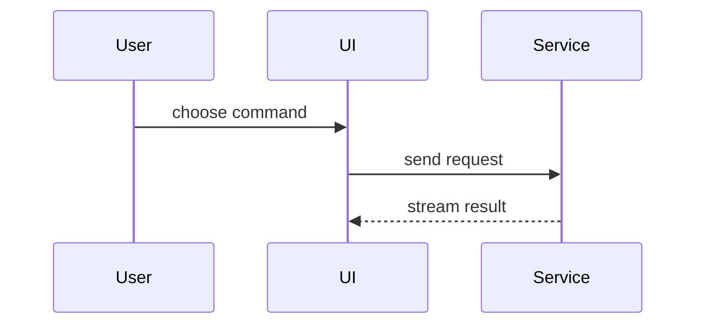

# Show me

> **Principles (always apply):** (1) **English only**: everything you write or generate is in English, including labels and diagram text, even when the source is not. (2) **Practices, not domain**: the visuals show the structure and flow of the topic in front of you, with generic names for anything that does not need its real name, and never copy business rules, values or URLs beyond what the reader needs. Details: [../sync/references/principles.md](../sync/references/principles.md).

Help the user understand the current topic of conversation visually. Skip the preamble and keep prose brief. Pick the smallest view that makes the key point clear.

## Pick the view

- **Logic or an algorithm**: pseudocode.

```text
on(save)
  if content is unchanged
    return cached result
  write new content
  return fresh result
```

- **Runtime control flow**: a call tree.

```text
submitForm
  createSession
    persistInput
    startWorker
  navigateToSession
```

- **UI structure**: a component tree, including the state and module boundaries that matter.

```text
<ItemPage> (src/routes/item)
  useItemEvents()
  <ItemToolbar>
    <ActionButton> (shared/ui)
```

- **File responsibility or a broad refactor**: a shallow file tree.

```text
src/
├── commands/       # parses user actions
├── sessions/       # owns session state
└── transport/      # sends requests
```

- **Component interaction, control flow or data flow**: Mermaid.



- **What changes, when the surrounding shape already exists**: a `diff` that matches the topic's shape (component tree, file tree, call tree or control flow).

```diff
 submitForm
   createSession
     persistInput
+    expandTemplate
     startWorker
-  navigateToSession
+  navigateToSession
+    subscribeToEvents
```

```diff
 src/
 ├── commands/
+│   └── show-me.ts       # expands the command
 ├── sessions/
-└── transport.ts
+└── transport/
+    ├── client.ts
+    └── stream.ts
```

- **The whole block**: when most of it is new, when omitted context would hide ownership or order, or when the user needs a copyable target shape.
- **A visual UI, a layout, a state comparison, or a concept too dense for Mermaid**: write one focused HTML file (a diagram, an infographic or a short slide deck, whichever fits). Match the product's colors, type, spacing and components, use real labels and data, and support desktop and mobile. Save it as `show-me-<description>.html` in the scratchpad or a temp folder, never in the repo, then open it: `xdg-open <path>` on Linux, `open <path>` on macOS. Where you cannot open a browser (Cursor, remote shells), give the user the full path instead.

## Guidance

Place each visual next to the short text it supports. Keep only the calls, files, props, states and boundaries needed to answer the user's current question or the options to resolve the current discussion point.

Use one view, or several when they help. It is unlikely you need all of them. Do not overwhelm the user.
